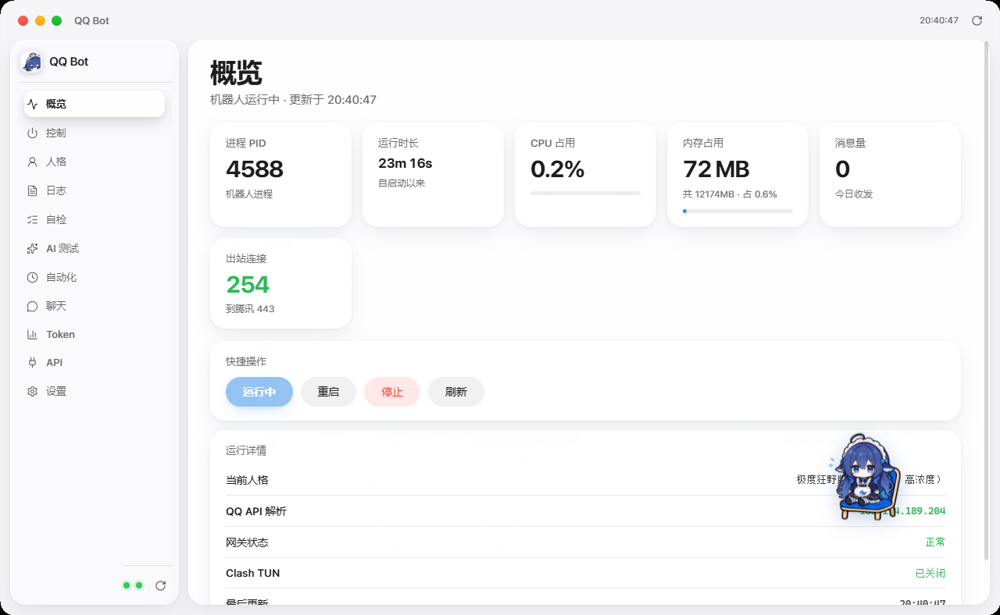

# Whale Console · 无网关版

> 不装 Agent2API，直接对接 DeepSeek 官方 API（或任何 OpenAI 兼容接口）的部署方案。
> 适合：只想让机器人跑起来、不想多维护一个本地网关进程的人。

<p align="center">
  
</p>

**想用模型网关（多家模型、免 API Key 额度）请改看 [`README.md`](README.md)。**

---

## 目录

- [一、能不能不装网关](#一能不能不装网关)
- [二、搭出来的样子](#二搭出来的样子)
- [三、需要搭配哪些组件](#三需要搭配哪些组件)
- [四、零基础部署](#四零基础部署)
- [五、换别家模型](#五换别家模型)
- [六、和网关版的差别](#六和网关版的差别)
- [七、给 AI Agent 的部署指令](#七给-ai-agent-的部署指令)
- [八、常见问题](#八常见问题)

---

## 一、能不能不装网关

**能。** 网关只是"把多家模型聚合成一个本地接口"的中间层，不是机器人的必要组件。

`patch.yml` 里的 `providers` 本来就是可插拔的：

```yaml
providers:
  local:      # 本机 Agent2API 网关（网关版用这个）
  deepseek:   # DeepSeek 官方 API（无网关版用这个）
```

不装网关，就把 `local` 删掉或注释掉，只留官方 provider。机器人照常收发消息。

代价：

| | 网关版 | 无网关版 |
|---|---|---|
| 模型数量 | 十几个（DeepSeek / Kimi / GLM / Hunyuan / Gemini…） | 只有你买了 Key 的那几家 |
| 费用 | 走网关额度 | 走官方账户余额，按量计费 |
| 要维护的进程 | 网关 + 机器人 + 控制台 | 机器人 + 控制台 |
| 看图能力 | 部分模型支持 | 取决于官方模型（DeepSeek 官方当前不支持图片输入） |

---

## 二、搭出来的样子

```
                    ┌──────────────────────────────────────┐
                    │  Whale Console（本项目）               │
                    │  启停 / 状态 / 日志 / Token / API /人格 │
                    └───────────────┬──────────────────────┘
                                    │ 只做进程管理 + 读日志
                                    ▼
  QQ 平台  ◄──►  DeepSeek Harness（DSH）  ────►  https://api.deepseek.com/v1
             im-qqbot          profile=whale              直连官方，没有中间层
```

少一个进程，少一个故障点。

---

## 三、需要搭配哪些组件

| 组件 | 必须 | 要求 | 作用 | 获取方式 |
|---|---|---|---|---|
| Windows | 是 | 10 1809+ / 11 | 运行环境 | — |
| .NET Framework 4.8 | 是 | 4.8 | 控制台运行时 | Win10 1903+ 自带 |
| WebView2 Runtime | 是 | 最新 | 渲染界面 | Win11 自带 |
| Node.js | 是 | 18+ | 跑 DSH | nodejs.org LTS |
| **DeepSeek Harness (DSH)** | 是 | 最新 | 机器人运行时 | `npm i -g @deepseek-ai/dsh` |
| QQ 机器人凭据 | 是 | — | AppID + AppSecret | QQ 开放平台 |
| **模型 API Key** | 是 | — | 官方账户的 Key | platform.deepseek.com 等 |
| Whale Console | 是 | — | 本仓库 | Releases 或自行编译 |
| Agent2API | **否** | — | 本方案不需要 | — |
| Python | 否 | 3.9+ | 采集聊天记录 | python.org |
| .NET SDK | 否 | 8+ | 改 C# 后编译 | dotnet.microsoft.com |

---

## 四、零基础部署

### 步骤 1：装 Node.js

https://nodejs.org 下载 LTS，一路下一步。验证：`node -v`。

### 步骤 2：装 DeepSeek Harness

```powershell
npm i -g @deepseek-ai/dsh
dsh --version
```

### 步骤 3：拿模型 API Key

到 https://platform.deepseek.com/api_keys 创建一个 Key（`sk-` 开头）。
**这一步要花钱/有余额，先确认账户里有额度。**

### 步骤 4：下载 Whale Console

解压到 `D:\qqbot`（路径不要有中文和空格）。

### 步骤 5：改 patch.yml（关键）

把 `providers` 改成只留官方一项：

```yaml
- id: llm-pi-ai
  name: '@deepseek-ai/dsh-llm-pi-ai'
  config:
    providers:
      deepseek:
        displayName: DeepSeek 官方
        apiKeyEnv: DEEPSEEK_OFFICIAL_KEY
        api: openai-completions
        baseURL: https://api.deepseek.com/v1
        models:
          - id: deepseek-chat
            name: DeepSeek Chat
            contextWindow: 128000
            maxTokens: 8192
            input: [text]
          - id: deepseek-reasoner
            name: DeepSeek Reasoner
            contextWindow: 128000
            maxTokens: 65536
            input: [text]
```

**两个硬性要求：**

1. `input` 只能写 `text` 或 `image`。写 `video` 会让机器人**启动直接崩溃**
   （报错：`expected "text" | "image" but got "video"`）。
   官方 DeepSeek 当前不支持图片，所以只写 `[text]`。
2. 密钥走环境变量，不要写进 `patch.yml`：

```powershell
[Environment]::SetEnvironmentVariable('DEEPSEEK_OFFICIAL_KEY', 'sk-你的官方密钥', 'User')
```

### 步骤 6：连通性自检

先单独验证 Key 能用，别急着启动机器人：

```powershell
$body = '{"model":"deepseek-chat","messages":[{"role":"user","content":"hi"}],"max_tokens":8}'
Invoke-RestMethod -Method Post 'https://api.deepseek.com/v1/chat/completions' `
  -Headers @{ 'Authorization' = 'Bearer ' + $env:DEEPSEEK_OFFICIAL_KEY; 'Content-Type' = 'application/json' } `
  -Body $body
```

能返回内容就说明 Key、网络、模型名都对。常见错误：

| 现象 | 原因 |
|---|---|
| 401 | Key 错了或没带 Bearer |
| 402 | 账户没余额 |
| 404 | 模型名写错 |

### 步骤 7：配置 QQ 凭据与人格

- AppID / AppSecret 写进 DSH profile 的 `cordis.yml`
- 人格写 `agent\AGENTS.md`

### 步骤 8：启动

```powershell
cd D:\qqbot
.\autostart.ps1
```

日志出现 `Bot ready! appId=xxxx` 即成功。然后双击 `QQBotConsole.exe`。

---

## 五、换别家模型

任何 OpenAI 兼容接口都能直接替换，改 `baseURL` 和模型名即可：

| 厂商 | baseURL | API Key 环境变量 |
|---|---|---|
| DeepSeek 官方 | `https://api.deepseek.com/v1` | `DEEPSEEK_OFFICIAL_KEY` |
| 月之暗面 Kimi | `https://api.moonshot.cn/v1` | 自建一个，如 `KIMI_KEY` |
| 智谱 GLM | `https://open.bigmodel.cn/api/paas/v4` | 自建 |
| 硅基流动 | `https://api.siliconflow.cn/v1` | 自建 |
| 通义千问 | `https://dashscope.aliyuncs.com/compatible-mode/v1` | 自建 |

示例（换成 Kimi）：

```yaml
      moonshot:
        displayName: Kimi
        apiKeyEnv: KIMI_KEY
        api: openai-completions
        baseURL: https://api.moonshot.cn/v1
        models:
          - id: moonshot-v1-8k
            name: Moonshot v1 8K
            input: [text]
```

控制台「API 管理」页也能填厂商地址和 Key，用来做连通性测试和记录，
**但机器人真正调用哪个模型，最终由 `patch.yml` 决定**。

---

## 六、和网关版的差别

| 项目 | 网关版 | 本方案 |
|---|---|---|
| 中间层进程 | 需要跑 Agent2API | 不需要 |
| 模型来源 | 网关聚合多家 | 自己配哪家就是哪家 |
| 默认模型 | `deepseek-v4.1-flash-sg` 等 | `deepseek-chat` |
| 图片输入 | 部分模型支持（`kimi-k3`、`hy3`） | 官方暂不支持，写 `[text]` |
| 故障点 | 多一个（网关挂了机器人就瞎） | 少一个 |
| 费用 | 走网关额度 | 官方账户按量计费 |

---

## 七、给 AI Agent 的部署指令

下面这段是**给 AI Agent 看的指令**。复制整个代码块发给任意支持执行命令的 AI Agent，
它就能按步骤帮你装好。不需要你理解里面内容。

````text
你是一名 Windows 部署助手。任务：帮我在这台 Windows 10/11 机器上部署
Whale Console（QQ 机器人控制台）+ DeepSeek Harness 机器人。

【重要】本方案不使用 Agent2API 网关，模型直接走 DeepSeek 官方 API。
不要安装、不要启动任何本地模型网关；如果检测到 127.0.0.1:3065 有服务，忽略它，不要动。

【仓库】https://github.com/hitikem/whale-console

【部署目标】
1. 机器人能连上 QQ 并收发消息
2. 模型调用直连 https://api.deepseek.com/v1
3. Whale Console 能启动、能看到机器人状态

【硬性约束】
- 安装目录固定在 D:\qqbot（路径不要有中文和空格）
- 密钥一律写进"用户级环境变量"，禁止写进任何文件、禁止提交到 git
- 不要把密钥内容打印出来，只确认"已写入"
- 每一步执行前说明要做什么，执行后如实报告并贴关键输出
- 报错时先贴完整错误信息，不要猜测、不要连续重试超过 2 次
- 不要修改人格文件 D:\qqbot\agent\AGENTS.md
- 未经我确认不要删除已有文件

【执行步骤】
第 1 步  环境检查
  报告：Windows 版本、node -v、npm -v、.NET Framework 4.8、WebView2 Runtime 是否存在。
  只报告，先别装。

第 2 步  安装 DSH
  缺 Node.js 18+ 就装 LTS；然后 npm i -g @deepseek-ai/dsh，验证 dsh --version。

第 3 步  获取本仓库
  下载/克隆到 D:\qqbot，列出目录结构确认有 QQBotConsole.exe、ui\、agent\、patch.yml、autostart.ps1。

第 4 步  配置官方 API Key
  向我要 DeepSeek 官方 API Key（我会单独发给你，你不要把它写进任何文件，也不要回显）。
  然后执行：
  [Environment]::SetEnvironmentVariable('DEEPSEEK_OFFICIAL_KEY','<我给的key>','User')

第 5 步  验证 Key 可用（先于一切）
  执行：
  $body = '{"model":"deepseek-chat","messages":[{"role":"user","content":"hi"}],"max_tokens":8}'
  Invoke-RestMethod -Method Post 'https://api.deepseek.com/v1/chat/completions' `
    -Headers @{ 'Authorization' = 'Bearer ' + $env:DEEPSEEK_OFFICIAL_KEY; 'Content-Type'='application/json' } `
    -Body $body
  把返回贴给我。若报 401/402/404，按错误码说明原因并停下等我处理。

第 6 步  改 patch.yml
  确认 llm-pi-ai 的 providers 里只有官方一项（不要有指向 127.0.0.1:3065 的 local）：
    deepseek:
      apiKeyEnv: DEEPSEEK_OFFICIAL_KEY
      api: openai-completions
      baseURL: https://api.deepseek.com/v1
      models: deepseek-chat / deepseek-reasoner
  硬性检查：所有 model 的 input 字段只允许 text 和 image；
  出现 video 立即停止并告诉我（那会导致 DSH 启动崩溃）。
  改完把这段 YAML 贴给我确认。

第 7 步  配置 QQ 凭据
  向我要 AppID 和 AppSecret，写进 DSH profile 的 cordis.yml（不要写进 patch.yml 明文，
  不要回显内容），只告诉我"已写入，位置是 XXX"。

第 8 步  启动机器人
  cd D:\qqbot ; .\autostart.ps1
  等 15 秒读 run-out.log 尾部，确认 "Bot ready"。
  run-err.log 有内容就把最后 20 行贴给我。

第 9 步  启动控制台
  启动 D:\qqbot\QQBotConsole.exe，确认进程存在、窗口标题为 "QQ Bot"。

第 10 步 验收
  向我报告：机器人 PID、当前使用的模型、run-out.log 尾部 5 行、控制台是否正常显示状态。

【完成标准】
1. run-out.log 有 "Bot ready"
2. QQBotConsole.exe 进程存在且窗口可见
3. 第 5 步的官方 API 调用返回了正常内容

【如果卡住】
任何一步失败超过两次就停下，整理简报给我：已完成步骤、失败步骤、完整错误信息。
等我决定，不要继续猜着改。
````

---

## 八、常见问题

**Q：完全不装网关，控制台还能用吗？**
能。控制台全部功能都在，只是「AI 测试」页能选的模型变成你在 patch.yml 里配的那些。

**Q：官方模型不支持图片，我的机器人要发图怎么办？**
两条路：装网关版（用 `kimi-k3` / `hy3`），或者在 patch.yml 里再加一家支持图片的厂商。

**Q：为什么机器人启动就崩？**
十有八九是 `patch.yml` 里某个模型的 `input` 写了 `video`。改成 `[text]` 或 `[text, image]`。

**Q：控制台里的「API 管理」和我改的 patch.yml 是什么关系？**
「API 管理」主要用来测试连通性和记录密钥；机器人实际调用的模型由 `patch.yml` 决定。
两边要保持一致，否则会出现"控制台测试通过，但机器人回不了话"。

---

## 许可

MIT。
