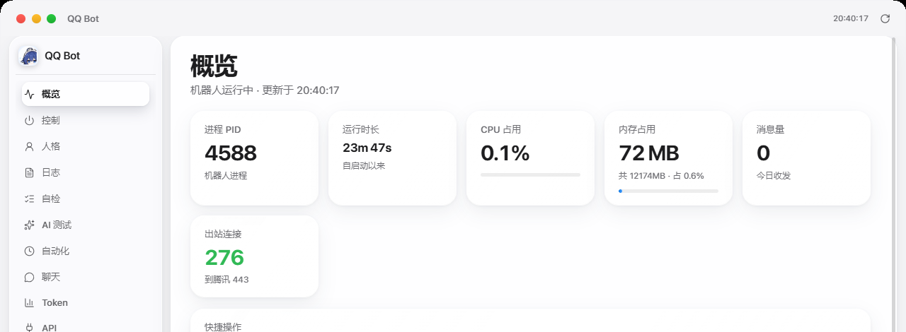

# Whale Console

> Windows 桌面 QQ 机器人控制台。C# WinForms + WebView2，液态玻璃界面。
> 一键启停 · 实时状态 · 聊天记录 · Token 用量 · API 管理 · 人格切换 · 故障自检

<p align="center">
  
</p>

<p align="center">
  
  
  
</p>

**本文件是「方案 A：带 Agent2API 模型网关」的完整说明。**
如果你不想装网关、直接用 DeepSeek 官方 API，请改看 [`README-NO-AGENT2API.md`](README-NO-AGENT2API.md)。

---

## 目录

- [一、先搞清楚它管什么、不管什么](#一先搞清楚它管什么不管什么)
- [二、需要搭配哪些组件](#二需要搭配哪些组件)
- [三、零基础部署（方案 A，含 Agent2API）](#三零基础部署方案-a含-agent2api)
- [四、模型与人格](#四模型与人格)
- [五、配置文件说明](#五配置文件说明)
- [六、开发者指南](#六开发者指南)
- [七、给 AI Agent 的部署指令](#七给-ai-agent-的部署指令)
- [八、常见问题](#八常见问题)

---

## 一、先搞清楚它管什么、不管什么

**Whale Console 不收发消息，也不做模型推理。** 它只是一个"遥控器 + 仪表盘"：
按按钮去启动/停止真正的机器人进程，并把机器人产生的状态、日志、聊天、用量显示出来。

**关掉控制台，机器人照样收发消息。**

```
                    ┌──────────────────────────────────────┐
                    │  Whale Console（本项目）               │
                    │  启停 / 状态 / 日志 / Token / API /人格 │
                    │  不参与消息链路                        │
                    └───────────────┬──────────────────────┘
                                    │ 只做进程管理 + 读日志
                                    ▼
  QQ 平台  ◄──►  DeepSeek Harness（DSH）  ◄──►  Agent2API 网关  ◄──►  各家大模型
             im-qqbot          profile=whale        127.0.0.1:3065
             官方机器人接口      本仓库 patch.yml     本方案的核心
```

**两条消息链路，二选一：**

| 链路 | 组件 | 特点 |
|---|---|---|
| **A（推荐）** | DSH 内置 `im-qqbot` 插件 | 走 QQ 官方机器人开放平台，需要 AppID + AppSecret，稳定合规 |
| **B（可选）** | NapCat / LLOneBot + `bridge.mjs` | 自部署协议端，走 OneBot v11，`bridge/` 目录里已实现 |

本文件默认讲链路 A；链路 B 见 [六、开发者指南](#六开发者指南) 末尾。

---

## 二、需要搭配哪些组件

| 组件 | 必须 | 要求 | 作用 | 获取方式 |
|---|---|---|---|---|
| Windows | 是 | 10 1809+ / 11 | 运行环境 | — |
| .NET Framework 4.8 | 是 | 4.8 | 控制台运行时 | Win10 1903+ 自带 |
| WebView2 Runtime | 是 | 最新 | 渲染界面 | Win11 自带；否则装 Evergreen 版 |
| Node.js | 是 | 18+ | 跑 DSH（机器人本体） | nodejs.org LTS |
| **DeepSeek Harness (DSH)** | 是 | 最新 | 机器人运行时（`im-qqbot` 插件） | `npm i -g @deepseek-ai/dsh` |
| QQ 机器人凭据 | 是 | — | AppID + AppSecret | QQ 开放平台申请 |
| **Agent2API** | 是（本方案） | — | 把多家模型聚合成一个 OpenAI 兼容接口 | 单独部署，默认 `127.0.0.1:3065` |
| 模型额度 / API Key | 是 | — | 真正消耗的东西 | 各家厂商或网关发放 |
| Whale Console | 是 | — | 本仓库 | Releases 或自行编译 |
| Python | 否 | 3.9+ | 采集聊天记录（`tools/collect-chat.py`） | python.org |
| .NET SDK | 否 | 8+ | 改 C# 源码后编译（只用它的 csc.dll） | dotnet.microsoft.com |
| NapCat / LLOneBot | 否 | — | 走链路 B 时才需要 | 各自仓库 |

---

## 三、零基础部署（方案 A，含 Agent2API）

全程约 20 分钟。按顺序做，每步都有验证方法。

### 步骤 1：装 Node.js

到 https://nodejs.org 下载 LTS，一路下一步。装完开一个 PowerShell 验证：

```powershell
node -v
npm -v
```

能打印版本号即通过。

### 步骤 2：装 DeepSeek Harness（机器人本体）

```powershell
npm i -g @deepseek-ai/dsh
dsh --version
```

### 步骤 3：装并启动 Agent2API 网关

Agent2API 的作用：把多家模型（DeepSeek / Kimi / GLM / Hunyuan / Gemini 等）
聚合成一个本地的 OpenAI 兼容接口，机器人只需要对接这一个地址。

部署完成后验证网关活着：

```powershell
Invoke-RestMethod -Uri 'http://127.0.0.1:3065/health'
# 期望返回 status=ok、loggedIn=true

(Invoke-RestMethod -Uri 'http://127.0.0.1:3065/v1/models').data.id
# 期望列出可用模型 id 列表
```

记下两样东西，后面要填：

| 项 | 示例 | 说明 |
|---|---|---|
| 网关地址 | `http://127.0.0.1:3065/v1` | 默认端口 3065 |
| API Key | `sk-a2a-xxxxxxxx` | 网关发放的密钥 |

### 步骤 4：下载 Whale Console

从 Releases 下载 `WhaleConsole-v1.0.0.zip`，解压到固定目录（**路径里不要有中文和空格**）：

```
D:\qqbot\
├─ QQBotConsole.exe
├─ ui\
├─ assets\
├─ agent\          ← 人格文件
├─ patch.yml       ← 模型配置
└─ autostart.ps1   ← 启动脚本
```

### 步骤 5：配置模型（patch.yml）

打开 `patch.yml`，核心结构是 `llm-pi-ai` 插件的 `providers`：

```yaml
- id: llm-pi-ai
  name: '@deepseek-ai/dsh-llm-pi-ai'
  config:
    providers:
      local:                          # ← 本方案：本机 Agent2API 网关
        displayName: 本地 AI 网关
        apiKeyEnv: AGENT2API_PROXY_API_KEY
        api: openai-completions
        baseURL: http://127.0.0.1:3065/v1
        models:
          - id: deepseek-v4.1-flash-sg
            name: DeepSeek V4.1 Flash SG（默认）
            contextWindow: 1000000
            maxTokens: 128000
            input: [text, image]
      deepseek:                       # ← 备用：官方 API
        displayName: DeepSeek 官方
        apiKeyEnv: DEEPSEEK_OFFICIAL_KEY
        api: openai-completions
        baseURL: https://api.deepseek.com/v1
        models:
          - id: deepseek-chat
            name: DeepSeek Chat
            input: [text]
```

把密钥写进**环境变量**（不要写进文件，也不要提交到仓库）：

```powershell
[Environment]::SetEnvironmentVariable('AGENT2API_PROXY_API_KEY', 'sk-a2a-你的密钥', 'User')
[Environment]::SetEnvironmentVariable('DEEPSEEK_OFFICIAL_KEY',   'sk-你的官方密钥', 'User')
```

### 步骤 6：配置 QQ 凭据与人格

- QQ AppID / AppSecret：填进 DSH profile 的 `cordis.yml`（或 `patch.yml` 的 `im-qqbot` 段）
- 人格：编辑 `agent\AGENTS.md`，这个文件就是机器人的"人设"，直接写中文即可

### 步骤 7：启动机器人

```powershell
cd D:\qqbot
.\autostart.ps1
```

看到 `Bot ready! appId=xxxx` 就是连上了。日志在 `run-out.log` / `run-err.log`。

### 步骤 8：启动控制台

双击 `QQBotConsole.exe`。第一屏应该能看到 PID、运行时长、CPU、内存。

### 步骤 9：验收

在控制台「AI 测试」页选一个模型发一条测试消息，能收到回复即完成。

---

## 四、模型与人格

### 模型

`patch.yml` 里配了多少个模型，控制台「AI 测试」页就能选多少个。

实测提醒（2026-10 的网关版本）：

| 模型 | 备注 |
|---|---|
| `deepseek-v4.1-flash-sg` | 默认，响应快 |
| `kimi-k3` | **真能看图** |
| `hy3` | **真能看图** |
| `glm-5.3` / `glm-5.2` | 能用，但元数据标了看图、实际不支持 |
| `deepseek-v4.1-flash` | 容易触发 429 限流 |

### 人格

- 文件：`agent\AGENTS.md`
- 控制台「人格」页可以切换、预览、编辑
- 改完**重启机器人生效**（控制台只负责写文件）

---

## 五、配置文件说明

| 文件 | 作用 |
|---|---|
| `patch.yml` | DSH 配置层：模型 providers、插件参数 |
| `agent\AGENTS.md` | 机器人人格（人设 prompt） |
| `logs\status.json` | 机器人状态快照，控制台每 90 秒读一次 |
| `logs\chat-data.json` | 聊天记录 |
| `logs\api-store.json` | 控制台里保存的 API 密钥（**明文，别外传**） |
| `autostart.ps1` | 启动机器人（含 cordis.yml 文件锁重试） |

---

## 六、开发者指南

### 目录结构

```
whale-console/
├─ QQBotConsole.cs        主程序（约 2100 行）
├─ NativeCollector.cs     状态采集（纯 C#，不用 PowerShell 子进程）
├─ Setup.cs               安装程序
├─ ui/
│  ├─ index.html          主界面 + 内联 JS（导航、通信、启动）
│  ├─ pages-new.js        11 个页面的动态渲染
│  ├─ pet.js              桌宠（独立模块）
│  ├─ winisland.css       设计系统
│  └─ liquid-glass.js     液态玻璃效果
├─ assets/                图标资源
├─ agent/                 人格文件
├─ bridge/                链路 B：OneBot v11 桥接（可选）
├─ tools/                 Python 小工具（采集聊天等）
└─ build/                 构建脚本
```

### 改前端：不用编译

`ui/` 是纯 HTML/CSS/JS，没有构建步骤。改完在控制台里按 `Ctrl+R` 刷新即可。

### 改 C#：必须重新编译

```powershell
$fw  = "C:\Windows\Microsoft.NET\Framework64\v4.0.30319"
$sdk = (Get-ChildItem "C:\Program Files\dotnet\sdk" -Directory |
        Where-Object { $_.Name -notlike '*preview*' } | Sort-Object Name | Select-Object -Last 1).FullName
$csc = Join-Path $sdk "Roslyn\bincore\csc.dll"

dotnet $csc /target:winexe /platform:x64 `
  /win32icon:assets\app.ico `
  /resource:assets\app.ico,app.ico `
  /out:QQBotConsole.exe `
  /reference:"$fw\mscorlib.dll" /reference:"$fw\System.dll" /reference:"$fw\System.Core.dll" `
  /reference:"$fw\System.Windows.Forms.dll" /reference:"$fw\System.Drawing.dll" `
  /reference:"$fw\System.Management.dll" /reference:"$fw\System.Net.Http.dll" `
  /reference:"$fw\System.Web.dll" /reference:"$fw\System.Web.Extensions.dll" `
  /reference:"lib\Microsoft.Web.WebView2.Core.dll" /reference:"lib\Microsoft.Web.WebView2.WinForms.dll" `
  /langversion:latest /nologo `
  src\QQBotConsole.cs src\NativeCollector.cs
```

**注意两点，漏了会出问题：**

1. 必须同时编译 `src\NativeCollector.cs`，否则报 `CS0103: NativeCollector`
2. 必须带 `/resource:assets\app.ico,app.ico`，否则托盘取不到多尺寸图标（生成的 exe 会小 128KB）

### 前后端怎么通信

WebView2 的 `file://` 页面**不能**直接 `fetch()` HTTP（CORS），全部走 `postMessage`：

```javascript
// JS → C#
window.chrome.webview.postMessage({ type: 'req', id: 1, path: 'api/status' });

// C# → JS（必须监听 chrome.webview，不能监听 window）
window.chrome.webview.addEventListener('message', e => { /* e.data */ });
```

### API 路由表

`api/status` `api/start` `api/stop` `api/restart` `api/ops` `api/refresh`
`api/log` `api/chat` `api/check` `api/dns` `api/gateway` `api/tun`
`api/models` `api/ai` `api/apis` `api/persona` `api/personas`
`api/auto` `api/config` `api/assist` `api/opendir` `api/window`

### 常见坑（踩过的，别重复）

1. **窗口拖动不是 `WM_NCHITTEST` 实现的**。WebView2 会吞掉鼠标消息，`HTCAPTION` 无效。
   实际方案是 16ms 定时器轮询 `GetAsyncKeyState` + `SetWindowPos`，代码在 `InitManualDrag()`。
   往里加"不可拖区域"要改 `IsDragArea()`，不是改 `WndProc`。
2. **窗口图标必须显式设置**。只给 `NotifyIcon` 设图标不够，`this.Icon` 不设的话
   任务栏会显示系统默认的彩色方块图标。
3. **DSH 模型的 `input` 只接受 `text` / `image`**。写 `video` 会直接启动崩溃。
4. **`cordis.yml` 有多进程文件锁**（EPERM）。用独立 profile + 重试机制规避。
5. **网关模型的 `supports_images` 不可信**，实测只有部分模型真能看图。
6. **密钥别进仓库**。提交前务必全文搜索 `sk-`。

### 链路 B：NapCat / LLOneBot（可选）

`bridge/bridge.mjs` 实现了 OneBot v11 ↔ 网关的桥接，QQ 登录由 NapCat 负责，
桥接进程只跟 NapCat 的本机端口说话，不碰 QQ 凭据。

```powershell
cd bridge
node bridge.mjs
```

环境变量：`GATEWAY_URL`（默认 `http://127.0.0.1:3065/v1`）、`PERSONA_FILE`（默认 `agent\AGENTS.md`）。

---

## 七、给 AI Agent 的部署指令

下面这段是**给 AI Agent 看的指令**。复制整个代码块，发给任意支持执行命令的 AI Agent，
它就能按步骤帮你把这套东西装起来。不需要你理解里面的内容。

````text
你是一名 Windows 部署助手。任务：帮我在这台 Windows 10/11 机器上部署
Whale Console（一个 QQ 机器人控制台）+ DeepSeek Harness 机器人 + Agent2API 模型网关。

【仓库】https://github.com/hitikem/whale-console

【部署目标】
1. 机器人能连上 QQ 并收发消息
2. 模型调用走本机 Agent2API 网关（http://127.0.0.1:3065/v1）
3. Whale Console 能启动、能看到机器人状态、AI 测试能收到回复

【硬性约束】
- 安装目录固定在 D:\qqbot（路径不要有中文和空格）
- 所有密钥一律写进"用户级环境变量"，禁止写进任何文件、禁止提交到 git
- 每一步执行前先说明你要做什么，执行后如实报告成功/失败并贴出关键输出
- 遇到报错不要猜测，先把完整错误信息贴出来再决定下一步
- 不要修改人格文件 D:\qqbot\agent\AGENTS.md 的内容
- 未经我确认，不要删除任何已有文件

【执行步骤】
第 1 步  环境检查
  检查并报告：Windows 版本、node -v、npm -v、.NET Framework 4.8 是否存在、
  WebView2 Runtime 是否存在。缺哪个就报缺哪个，先别动手装。

第 2 步  安装依赖
  - 缺 Node.js 18+ 就安装 LTS，装完验证 node -v
  - 执行 npm i -g @deepseek-ai/dsh，验证 dsh --version

第 3 步  获取本仓库
  把仓库下载/克隆到 D:\qqbot，确认目录里有 QQBotConsole.exe、ui\、agent\、patch.yml、
  autostart.ps1。列出实际目录结构给我看。

第 4 步  启动并验证 Agent2API 网关
  - 若未安装，先说明并询问我要不要继续（不要擅自下载来历不明的二进制）
  - 网关起来后执行两条验证：
    Invoke-RestMethod http://127.0.0.1:3065/health   （期望 status=ok）
    (Invoke-RestMethod http://127.0.0.1:3065/v1/models).data.id
  - 把可用的模型 id 列表贴给我

第 5 步  配置密钥
  让我提供网关 API Key 和（可选的）DeepSeek 官方 Key，然后执行：
  [Environment]::SetEnvironmentVariable('AGENT2API_PROXY_API_KEY','<我给的key>','User')
  不要把 key 打印到输出里，只确认"已写入"。

第 6 步  配置 patch.yml
  确认 D:\qqbot\patch.yml 里 llm-pi-ai 的 providers 至少有 local（指向 127.0.0.1:3065/v1）
  和 deepseek（官方备用）两项；model 的 input 字段只允许 text 和 image，出现 video 就报错停止。
  把当前 patch.yml 的模型段落贴给我确认。

第 7 步  配置 QQ 凭据
  让我提供 QQ 机器人的 AppID 和 AppSecret，写进 DSH 的 profile 配置（不要写进 patch.yml 明文）。
  写完后告诉我"配置已写入，位置是 XXX"，不要把凭据内容打印出来。

第 8 步  启动机器人
  cd D:\qqbot ; .\autostart.ps1
  等待 15 秒后读取 run-out.log 尾部，确认出现 "Bot ready"。
  若 run-err.log 有内容，把最后 20 行贴给我，不要自行重试超过 2 次。

第 9 步  启动控制台
  启动 D:\qqbot\QQBotConsole.exe，确认进程存在、窗口标题为 "QQ Bot"。

第 10 步 验收
  在控制台「AI 测试」页选一个可用模型，发送一条测试消息，确认收到回复。
  向我报告：机器人 PID、使用的模型、测试回复内容、控制台是否正常显示状态。

【完成标准】
同时满足以下三条才算完成：
1. run-out.log 有 "Bot ready"
2. QQBotConsole.exe 进程存在且窗口可见
3. AI 测试能收到模型回复

【如果卡住】
任何一步失败超过两次，停下来，把已完成的步骤、失败的步骤、完整错误信息
整理成一份简报给我，等我决定，不要继续猜着改。
````

---

## 八、常见问题

**Q：关掉控制台，机器人还工作吗？**
会。控制台只是管理界面，机器人是独立的 node 进程。

**Q：状态显示"—"或一直转圈？**
后端每 90 秒采集一次，刚启动等一会儿。超过 2 分钟还是空，检查 `autostart.ps1` 是否真的拉起了进程。

**Q：改了人格没生效？**
人格改完要**重启机器人**，只重启控制台没用。

**Q：任务栏/桌面图标是默认的彩色方块？**
Windows 图标缓存没刷新。停掉 explorer → 删 `%LOCALAPPDATA%\IconCache.db`
和 `%LOCALAPPDATA%\Microsoft\Windows\Explorer\iconcache_*.db` → 重启 explorer。

**Q：拖桌宠会把整个窗口一起拖走？**
正常应该是宠物动、窗口不动。如果出现连带拖动，是前端的"不可拖区域"没上报成功，
检查控制台日志里有没有 `nodrag?rects=` 记录。

---

## 许可

MIT。图标与第三方资源见 `assets/icons/NOTICE.md`。
